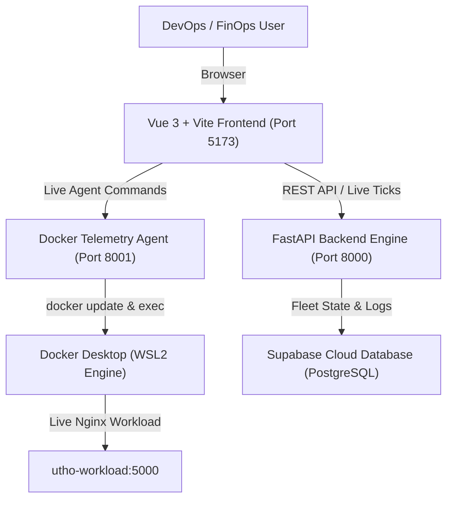

# SmartCloud Optimizer — Enterprise FinOps & Autonomous Cloud Scaler

[](https://fastapi.tiangolo.com)
[](https://vuejs.org)
[](https://tailwindcss.com)
[](https://www.docker.com)
[](https://supabase.com)
[](#)

> **SmartCloud Optimizer** is an audit-grade FinOps Cloud Optimization and Live Container Scaling platform engineered for the **UTHO Problem Statement (TRANSFINITTE 2026)**. It monitors provisioned virtual machines, predicts compute/memory bottlenecks, detects off-peak idle windows, executes scheduled turn-offs, purges orphaned assets, and dynamically scales live Docker container workloads with **zero downtime**.

---

## 📋 Problem Statement Context & Scenario

* **Target Organization**: **ZenithFlow Technologies Pvt Ltd** — A fast-growing mid-sized Indian B2B SaaS company.
* **The Challenge**: Monthly cloud bill escalated by **+40.0% in 6 months** (rising from ₹2,95,000 to ₹5,52,100/mo), compressing gross margins and threatening quarterly budgets.
* **Infrastructure Scope**: 50+ managed cloud resources distributed across Indian datacenters:
  * **Noida (North)**
  * **Bangalore (South)**
  * **Mumbai (West)**
* **Environments**: Production (`prod`), Staging (`staging`), and Development (`dev`).
* **Resource Types**: Virtual Machines (Compute), Block Storage Volumes (SSD), and Elastic Public IPs.

---

## 🚀 Key Features & UTHO Deliverables

### 1. 📊 Multi-Filter Inventory Dashboard
* Filter the entire 50-resource fleet across **Region** (*Noida*, *Bangalore*, *Mumbai*), **Environment** (*Prod*, *Staging*, *Dev*), **Resource Type** (*VMs*, *Block Volumes*, *Public IPs*), and **Anomaly Signals** (*Bottlenecks*, *Downsize*, *Orphaned*, *Anomalies*).
* Live telemetry indicators: Average CPU %, RAM %, **p95 CPU %**, and bidirectional **Network In/Out (MB/s)**.

### 2. 🛡️ Peak-Safe Rightsizing Engine (p95 & p99 Thresholds)
* **Never resize on averages alone**: Naive tools shrink instances based on 24-hour averages, which crashes bursty production workloads during traffic spikes.
* **Strict Peak Protection Rule**:
  $$\text{If } \text{p95\_CPU} \ge 75.0\% \quad \text{or} \quad \text{p99\_CPU} \ge 85.0\% \implies \textbf{PROHIBIT DOWNSCALE}$$
* *Real Example*: `checkout-order-prod-01` has 48% average CPU, but spikes to **94.8% p99** during lunch/dinner flash sales. Our engine explicitly locks this node as **Peak Protected**.

### 3. 🎯 All 4 Actionable Recommendation Categories
* **Resize**: Downscale overprovisioned instances with verified low p95 peaks (e.g. `auth-core-prod-01`).
* **Schedule Off-Hours**: Automate 8 PM–8 AM weekday + full weekend shutoff for Dev clusters (108 idle hours/week) and batch reconciliation nodes (saving 20.5 idle hrs/day).
* **Stop / Terminate Idle**: Flag and terminate rogue processes (e.g. staging runaway regex loop burning ₹18.4k/mo).
* **Clean Orphaned Assets**: Identify unattached SSD volumes (0 IOPS for $\ge 30$ days) and unused static public IPs to eliminate 100% waste.

### 4. 🔄 Interactive Accept / Reject Toggles with Dynamic Recalculation
* Toggle individual recommendations directly in table rows or decision cards.
* Clicking **Accept** or **Reject** calls `POST /api/recommendation/{id}/toggle`, immediately recalculating projected spend, monthly savings, and updating audit log trails in real time.

### 5. 🚨 Alerts & Insights Hub (4 Mandatory UTHO Findings)
Accessible via the top-bar **Alerts & Insights [4]** drawer, offering structured plain-language diagnoses:
1. **Unusual Spike & Anomaly**: Staging worker pegged at 99.4% CPU for 44 hours due to an infinite regex evaluation loop.
2. **Sudden Cost Growth Decomposition**: Root-cause audit explaining the **+40.0% bill surge** (Dev 24/7 weekend waste: ₹45.2k, overprovisioned cores: ₹60.2k, orphaned disks/IPs: ₹12.6k).
3. **Capacity Limit Warning**: Production checkout API hitting 94.8% CPU during peak deals — protected from downsizing.
4. **Projected Budget Overrun**: Run rate trending at ₹5,52,100/mo vs ₹4,50,000 budget limit (+22.7% overrun) with clear remediation steps.

### 6. 📑 Recommendation Exporters (IaC & CLI Runbooks)
* **Terraform HCL Export**: Generates production-ready `smartcloud_finops_remediation.tf` configuring Azure scheduled shutdown policies (`azurerm_dev_test_global_vm_shutdown_schedule`) and storage snapshot archives.
* **Azure CLI Runbook**: Generates executable `smartcloud_remediation.sh` for 1-click terminal execution (`az vm auto-shutdown`, `az disk delete`, `az network public-ip delete`).

### 7. 🌿 Sustainability & ESG Carbon Model
* Grounded in **Central Electricity Authority (CEA) of India** grid emissions data (**0.82 kg CO₂e / kWh**, 0.08 kWh/vCPU-hour).
* ZenithFlow fleet remediation avoids **2,715 kg CO₂e / month**, saving **3,311 kWh** of electricity, equivalent to planting **125 mature trees**.

### 8. 👤 3-Way FinOps Persona Switcher
* **Cloud Engineer**: Telemetry time series, vCPU utilization, Disk IOPS, network rates, and live container resizing.
* **FinOps Lead**: Unit pricing proration, environment before-vs-after matrices, and individual recommendation toggles.
* **Executive Leadership / CTO**: 40% growth decomposition, annual run-rate savings (₹16.9 Lakhs/year), budget variance, and ESG carbon abatement.

### 9. 🐳 Live Zero-Downtime Docker Container Scaler
* Real agent daemon (`docker_agent.py`) monitoring container `utho-workload` (`nginx:alpine`) on port 5000.
* Multi-tier dynamic scaling up to **8 vCPUs** using live `docker update`:
  * **Tier 0 (Baseline)**: 2.0 vCPUs, 2 GB RAM.
  * **Tier 1 (Burst)**: 4.0 vCPUs, 4 GB RAM.
  * **Tier 2 (High Stress)**: 6.0 vCPUs, 6 GB RAM (brings 400% stress to $< 70\%$ normalized load).
  * **Tier 3 (Extreme Stress)**: 8.0 vCPUs, 8 GB RAM.
* Automated cooldown: Reverts to 2.0 vCPUs after 8 seconds of low load.

---

## 🏗️ Architecture & Technology Stack



| Layer | Technologies Used |
| :--- | :--- |
| **Frontend** | Vue 3 (Composition API), Vite 6, TypeScript, Tailwind CSS, TailAdmin Pro UI, ApexCharts |
| **Backend API** | Python 3.12, FastAPI, Pydantic v2, Uvicorn, JSON/SQLite persistence |
| **Agent & Scaler** | Python `docker` SDK, `psutil`, multi-threaded watchdog, `docker update` engine |
| **Database & Auth** | Supabase (PostgreSQL tables: `vms`, `user_accounts`, `audit_logs`) |
| **Target Workload** | Docker Linux container `utho-workload` running `nginx:alpine` (port 5000:80) |

---

## 🔬 6 Modeled Workload Patterns (UTHO Fleet)

| # | Pattern Name | Example Resource | Region & Env | Specs & Baseline | Behavior & Sizing Decision |
| :-: | :--- | :--- | :--- | :--- | :--- |
| **1** | **Steady Low Usage** | `auth-core-prod-01` | Bangalore • `prod` | 8 vCPU, 32GB (₹18,400) | Sustained 14.8% CPU, p95 peak 24.2%. **Safe to downscale to 4 vCPUs** (saves ₹4,520/mo). |
| **2** | **Bursty Peak Workload** | `checkout-order-prod-01` | Mumbai • `prod` | 8 vCPU, 64GB (₹26,800) | Average CPU 48%, but **p99 hits 94.8%** during flash sales. **PROHIBIT DOWNSCALE**. Protects ₹1.2 Cr daily GMV. |
| **3** | **Batch Night Workload** | `batch-reconciliation-01` | Noida • `prod` | 4 vCPU, 16GB (₹9,700) | Active 01:00–04:30 AM (3.5 hrs/day). Idle 20.5 hrs/day. **Scheduled hibernation** (saves ₹5,200/mo). |
| **4** | **Weekend Dev Idling** | `dev-k8s-worker-pool-01` | Bangalore • `dev` | 16 vCPU, 64GB (₹38,400) | 108 idle hours/week (nights + full weekends). **Auto-shutdown schedule** (saves ₹22,600/mo). |
| **5** | **Orphaned SSD & IP** | `vol-blr-staging-unattached-1tb` | Bangalore • `staging` | 1000 GB Ultra SSD (₹8,400) | 0 IOPS for 60 days post-migration. **Snapshot archive & delete** (saves ₹8,400/mo pure waste). |
| **6** | **Runaway Anomaly** | `staging-crawler-worker-02` | Noida • `staging` | 8 vCPU, 32GB (₹18,400) | Infinite regex loop pegged at **99.4% CPU for 44 hours**. **Kill process PID & downscale** (saves ₹13,600/mo). |

---

## 📡 REST API Reference

| Method | Endpoint | Description |
| :--- | :--- | :--- |
| `GET` | `/health` | Health check for backend API |
| `GET` | `/api/vms?customerId=cust-zenith` | List all resources with multi-filtering (`region`, `environment`, `resourceType`, `team`) |
| `GET` | `/api/vm/{id}` | Detailed resource specs, recommendation breakdown, and 30-day time series |
| `GET` | `/api/vm/{id}/live-tick` | Real-time 2.5s meter telemetry stream (CPU%, RAM%, Disk IOPS, Net) |
| `POST` | `/api/recommendation/{id}/toggle` | Accept or reject recommendation; recalculates fleet spend live |
| `GET` | `/api/fleet/summary` | Fleet-wide aggregates, environment breakdowns, 40% surge decomposition, ESG data |
| `GET` | `/api/alerts` | 4 categorized UTHO alerts with structured plain-language explanations |
| `GET` | `/api/export/terraform` | Downloadable Terraform HCL plan (`smartcloud_finops_remediation.tf`) |
| `GET` | `/api/export/cli` | Downloadable Azure CLI remediation Bash script (`smartcloud_remediation.sh`) |
| `GET` | `/api/assumptions` | Structured JSON of unit pricing, 730 hr/mo rule, and p95/p99 logic |
| `POST` | `/api/docker/connect` | Connects remote or local Docker agent and adds container to user fleet |
| `POST` | `/api/docker/scale` | Triggers dynamic live resize (`cpus`, `memory`) on container workload |

---

## ⚡ Quickstart & Installation

### Prerequisites
* Windows 10/11 or Linux with PowerShell / Bash
* Python 3.10+ (installed with pip & venv)
* Node.js 18+ and npm
* Docker Desktop (with WSL2 engine on Windows)

---

### Step 1: Start Docker Desktop & Target Container
```powershell
# 1. Start Docker Backend (Windows PowerShell)
Start-Process "C:\Users\adars\AppData\Local\Programs\DockerDesktop\resources\com.docker.backend.exe" -ArgumentList "-unattended", "-with-frontend=false" -WindowStyle Hidden

# 2. Wait 3 seconds and ensure target container is running
Start-Sleep -Seconds 3
& "C:\Users\adars\AppData\Local\Programs\DockerDesktop\resources\bin\docker.EXE" start utho-workload
```

---

### Step 2: Start the FastAPI Backend (Port 8000)
```powershell
cd "backend"
# Activate Python Virtual Environment
.venv\Scripts\Activate.ps1
# Run FastAPI server with Uvicorn
python -m uvicorn app.main:app --host 0.0.0.0 --port 8000
```
*API will be available at: `http://127.0.0.1:8000` (Swagger docs: `http://127.0.0.1:8000/docs`)*

---

### Step 3: Start the Docker Scaling Agent (Port 8001)
```powershell
# In a new terminal window:
cd "smartcloud-optimizer"
backend\.venv\Scripts\python.exe docker_agent.py
```
*Agent will be available at: `http://localhost:8001`*

---

### Step 4: Start the Vue 3 Frontend (Port 5173)
```powershell
# In a new terminal window:
cd "frontend"
npm install
npm run dev
```
*Open dashboard in your browser at: **`http://localhost:5173`***

---

## 🧪 Verification & Demo Walkthrough

### 1. Multi-Filter Navigation
* Click **Noida**, **Bangalore**, or **Mumbai** pills to filter regional workloads.
* Click **prod**, **staging**, or **dev** to view environment-specific allocations.
* Click **Block Storage** or **Public IPs** to immediately spot the unattached orphaned assets.

### 2. Interactive Recommendation Acceptance
1. Locate `auth-core-prod-01` in the table or click **Inspect Specs**.
2. Notice baseline spend: **₹18,400/mo**, projected spend: **₹13,880/mo** (saves ₹4,520/mo).
3. Click **+ Accept** in the table row:
   * Projected spend updates immediately across top metrics cards and environment summary.
   * Audit log entry is recorded.
4. Click **✓ Accepted** to revert, demonstrating bidirectional state persistence.

### 3. Alerts & Insights Modal
* Click the red **Alerts & Insights [4]** button in the top navigation bar.
* Inspect the 4 plain-language cards explaining:
  * Runaway regex loop on staging
  * 40% cost increase decomposition
  * Checkout API p99 capacity peak
  * Month-end budget overrun

### 4. Assumptions & Methodology Sheet
* Click **Assumptions Sheet** in the top navigation or view [ASSUMPTIONS.md](ASSUMPTIONS.md).
* Review full unit pricing (₹84/USD), 730 hr/mo conversion, p95/p99 peak safety rules, and CEA carbon formulas.

### 5. Live Docker Container Stress Test & Dynamic Scaling
1. On the dashboard, locate the **Docker Host (utho-workload)** bar.
2. Click **Inject High CPU Stress**.
3. Watch the CPU usage surge to 400% across cores.
4. Within 2 seconds, the autonomous watchdog fires:
   * Container is dynamically resized from **2.0 cores $\to$ 6.0 cores** with **0ms downtime**.
   * Normalized CPU drops to **66.7%** ($< 70\%$).
5. Click **Stop Stress**:
   * Container cools down and automatically reverts to baseline 2.0 cores after 8 seconds.

---

## 📄 Key Project Files

```
smartcloud-optimizer/
├── ASSUMPTIONS.md                      # Audit-grade assumptions & pricing sheet
├── README.md                           # Master documentation (this file)
├── docker_agent.py                     # Standalone FastAPI Docker scaler & stress daemon
├── supabase_schema.sql                 # Supabase PostgreSQL schema (vms, user_accounts)
├── backend/
│   ├── app/
│   │   ├── main.py                     # FastAPI REST API & FinOps recommendation engine
│   │   ├── utho_dataset.py             # 50-resource Indian fleet generator & telemetry
│   │   └── persistence.py              # Local JSON & SQLite backup persistence store
│   └── data/
│       └── fleet_store.json            # Persistent state store
└── frontend/
    ├── src/
    │   ├── views/
    │   │   └── Ecommerce.vue           # Main FinOps Dashboard View with Persona Switcher
    │   ├── composables/
    │   │   └── useFinOps.ts            # Global reactive FinOps state & API client
    │   └── components/ecommerce/
    │       ├── EcommerceMetrics.vue    # Top metric cards (40% surge, budget safeguard, ESG)
    │       ├── RecentOrders.vue        # Multi-filter inventory table with row-level toggles
    │       ├── PredictiveDecisions.vue # Environment Before vs After table & peak safety
    │       ├── StatisticsChart.vue     # Telemetry chart (vCPU, RAM, Disk IOPS, Net In/Out)
    │       ├── VmShutdownSimulator.vue # What-If off-hours & weekend shutdown simulator
    │       ├── VmSpecsCard.vue         # Live resource gauge meters & hardware inspector
    │       ├── AlertsDrawer.vue        # Modal drawer with 4 categorized plain-language alerts
    │       ├── AssumptionsModal.vue    # In-app Assumptions Sheet modal
    │       └── DockerConnectorModal.vue# Docker host live scaling & stress controller
```

---

## 🏆 Hackathon Compliance Checklist

- [x] **50–150 Resources**: 50 managed resources across Noida, Bangalore, and Mumbai.
- [x] **Environments**: Explicit split across Production, Staging, and Development.
- [x] **Resource Types**: Virtual Machines, Block Volumes, and Public Elastic IPs.
- [x] **30-Day Time Series**: CPU%, RAM%, Disk IOPS, and Network In/Out (MB/s).
- [x] **6 Workload Patterns**: Bursty, batch, weekend dev, orphaned disks, unallocated IPs, runaway loop.
- [x] **Peak-Safe Rightsizing**: p95/p99 peak safety locks protecting critical production workloads.
- [x] **4 Action Categories**: `resize`, `schedule`, `stop`, `delete`.
- [x] **Before vs After Cost Summary**: Per-recommendation, per-environment, and in total.
- [x] **Interactive Accept / Reject**: Live dynamic cost recalculation.
- [x] **Categorized Alerts**: Spikes, 40% growth breakdown, capacity limits, budget overrun.
- [x] **IaC & CLI Exporters**: Downloadable Terraform HCL & Azure CLI Runbook.
- [x] **Assumptions Sheet**: `ASSUMPTIONS.md` and in-app modal.
- [x] **Live Container Workload**: Zero-downtime dynamic scaling on `utho-workload`.
